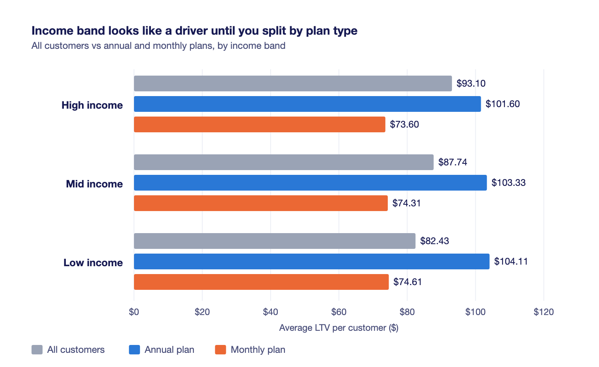

# Solution — Find What Drives LTV and Make One Spend Change

*Worked solution. This solution adds the judgment calls needed to separate a true driver of lifetime value from a false lead, and the marketing instinct required to push back on an AI tool's budget recommendation. The finished write-up is in [`allocation-note.md`](allocation-note.md); the income-band chart is [`ltv-driver-chart.png`](ltv-driver-chart.png).*

In this solution, we attach [`steep_cohorts_exercise.csv`](../starter/steep_cohorts_exercise.csv) to a new chat and ask Claude to answer four specific questions about what drives lifetime value for Steep, a direct-to-consumer tea brand:

1. What segments are the highest and lowest lifetime value?
2. What single customer attribute drives lifetime value the most?
3. What is an attribute that looks like it drives lifetime value, but can probably be explained away by something else?
4. What's one thing you might do differently with your spending based on this information?

## How to read the segments and confounds

The method used here is a simplification: average observed tenure multiplied by the average monthly fee. While this undervalues customers who are still active, it provides a baseline for comparison. The request looks like this:

> Here is a file of customer data. Each row is one customer with their acquisition details, plan type, monthly fee, observed tenure, status, revenue to date, and acquisition cost. Segment these customers by lifetime value (a simple estimate of tenure times monthly fee is fine) and tell me what most separates high-value from low-value customers. Where one attribute looks like it drives value, check whether it is actually explained by another attribute before concluding. Show the segment tables you base it on.

The results show that plan commitment drives value. Annual plan customers average $102.74, while monthly customers average $74.34. Annual customers are worth about 38% more.

| Plan type | Customer count | Average LTV |
|---|---|---|
| Annual | 2,210 | $102.74 |
| Monthly | 2,590 | $74.34 |

Income band initially looks like a driver, but it is a confound. High-income users simply choose the annual plan more often. Within a single plan type, lifetime value remains flat across all income levels. The split is by plan commitment, not necessarily high-value types of people.

*This chart displays average LTV by income band and shows that income is a confound of plan type since LTV remains flat within each plan.*

## The judgment call on spending

Claude suggests shifting the acquisition budget to referral programs because they have the lowest acquisition cost. We push back on this suggestion. Optimizing for cheap conversions buys the customers who are cheap to buy, not necessarily the most valuable ones. The strategic spend change is to target and incentivize sign-ups for the annual plan directly, since those users deliver much more lifetime value to the business.

To generate the final summary, we ask for four specific outputs:

> Draft a short write-up (under 200 words) covering exactly four things:  
> **Segments:** The highest- and lowest-value customer segments.  
> **Driver:** The single biggest driver of lifetime value.  
> **Confound:** One attribute that looked like a driver but was actually explained by something else, and what it was really explained by.  
> **Action:** One specific change to how we'd spend to acquire customers, based on this.  
> Plain language, for a marketing lead.

## Common mistakes to avoid

- **Accepting the first budget recommendation:** The chat assistant may default to the cheapest acquisition cost, so you end up buying low-value customers.
- **Ignoring active customers:** Calculating value as observed tenure multiplied by monthly fee is a simplification that undervalues customers who are still active, so your long-term projections fall short.
- **Stopping at the first correlation:** Assuming an attribute like income drives value without checking if it simply correlates with the true driver, so you target the wrong audience.
